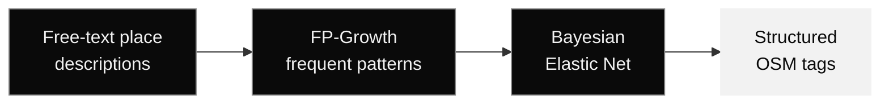

<div align="center">


<a href="https://github.com/phaze7r">
  
</a>

<br><br>

[](https://linkedin.com/in/faizan7r)
[](mailto:faizan@texodus.tech)
[](https://texodus.tech)

</div>

```text
~ $ whoami
faizan — founder · lead AI software engineer · researcher

~ $ cat now.txt
shipping   →  Texodus INC (web, AI, AI SEO)
researching →  geospatial tagging of volunteered place descriptions
learning   →  machine learning, properly, through the thesis
open to    →  NLP · OSM tags · Omarchy & Omarchy plugins
```

## Research

> **Geospatial Tagging of Volunteered Place Descriptions** — *thesis in progress*

People describe places in messy free text. The goal is to turn that into clean, structured OpenStreetMap-style tags.



## Experience

| | |
| :-- | :-- |
| **Founder & Lead AI Software Engineer** | [Texodus INC](https://texodus.tech) |
| What I do | Web development, AI-powered products, and AI SEO: getting brands found by search engines and by AI assistants. |

## Pinned work

<sub>Synced automatically from my GitHub pins every few hours.</sub>

<!--PINS:START-->
_Pins sync here on the next run of the workflow._
<!--PINS:END-->

## Activity

<p align="center">
  
</p>

<p align="center">
  
  
</p>

<p align="center">
  
</p>

## Let's build something

Collaboration is open on **NLP**, **OSM tags**, and **Omarchy plugins**. If it sits near geospatial, language or AI, say hi.

<div align="center">

**[faizan@texodus.tech](mailto:faizan@texodus.tech)** · **[linkedin.com/in/faizan7r](https://linkedin.com/in/faizan7r)** · **[texodus.tech](https://texodus.tech)**


</div>
