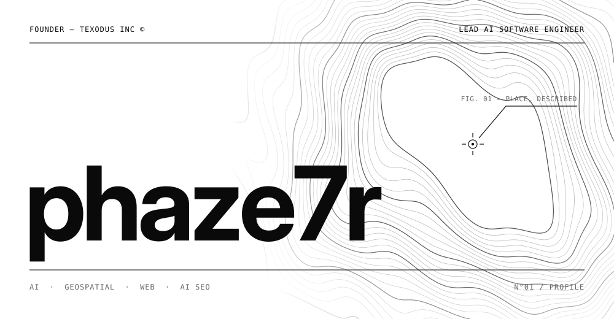
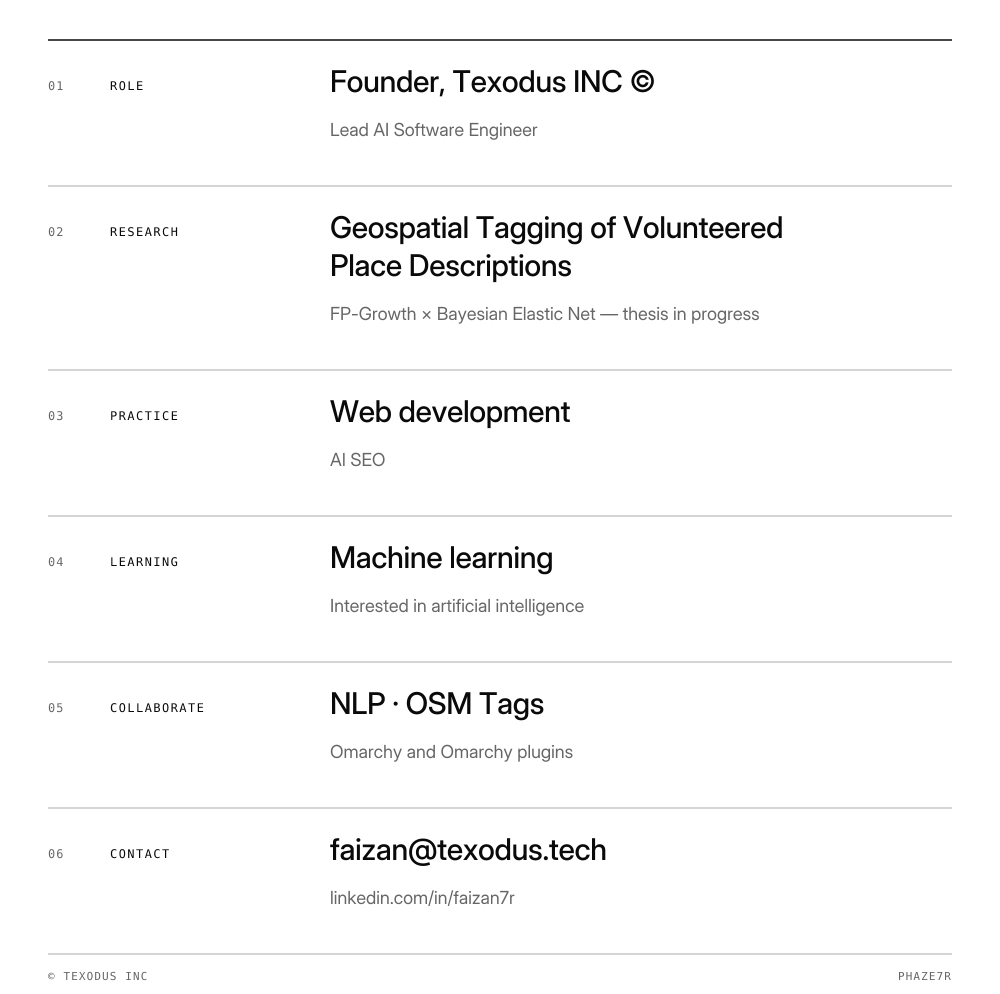

<picture>
  <source media="(prefers-color-scheme: dark)" srcset="assets/hero-dark.svg">
  
</picture>

<picture>
  <source media="(prefers-color-scheme: dark)" srcset="assets/index-dark.svg">
  
</picture>

  &nbsp;
  &nbsp;
  

---

## Profile

Founder of **Texodus INC** and lead AI software engineer. I build web products and AI-driven systems, and I research how people describe places in natural language and how those descriptions can be turned into structured geospatial tags.

## Experience

**Founder & Lead AI Software Engineer — [Texodus INC](https://texodus.tech)**
Building the company and its products end to end: web development, AI features and AI-search visibility (AI SEO).

## Research

**Geospatial Tagging of Volunteered Place Descriptions** *(thesis in progress)*
Mapping free-text place descriptions to OpenStreetMap-style tags using **FP-Growth** frequent-pattern mining and a **Bayesian Elastic Net**.

## Focus

| Area | What I'm doing |
| :-- | :-- |
| Web development | Shipping production sites and products at Texodus INC |
| AI SEO | Making brands visible to search engines and AI assistants |
| Machine learning | Learning it in depth, driven by the thesis work |
| NLP & OSM tags | Active research area, open to collaboration |
| Omarchy | Open to collaborating on Omarchy and Omarchy plugins |

## GitHub activity

  

  
  &nbsp;
  

## Let's work together

I'm open to collaborating on **NLP**, **OSM tags**, and **Omarchy plugins**.

**Email** [faizan@texodus.tech](mailto:faizan@texodus.tech) · **LinkedIn** [faizan7r](https://linkedin.com/in/faizan7r) · **Web** [texodus.tech](https://texodus.tech)
